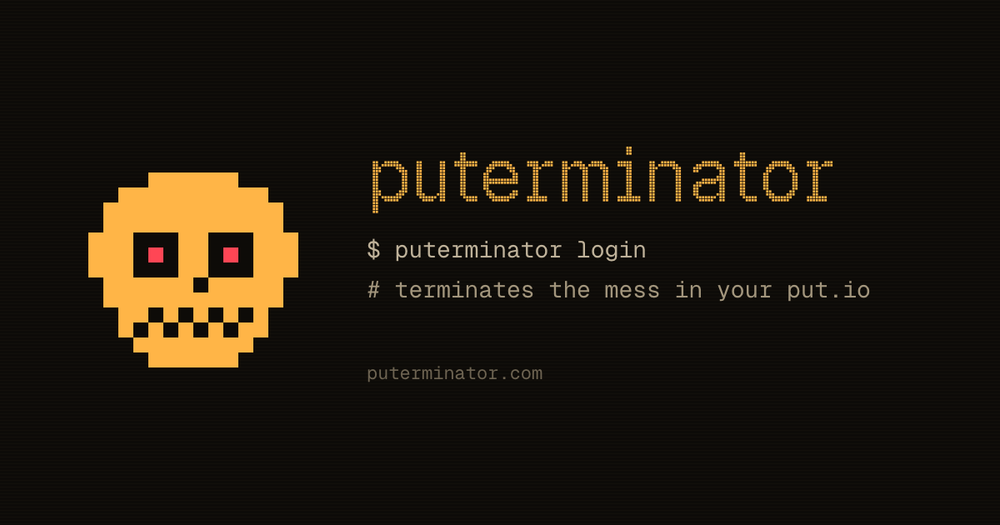

# puterminator

A chat agent for your put.io library, at [puterminator.com](https://puterminator.com).

- Scores a folder for junk, duplicates, release names and wrapper folders.
- Finds files, plays videos in the browser and makes put.io download links.
- Proposes renames, moves and trash as a diff. Trash goes to put.io's trash, and an applied plan can be undone.
- Free: 300 credits a month for everyone, from a shared monthly budget.

## Run it

Node 24 and pnpm.

```sh
pnpm install
pnpm dev:fake   # http://localhost:1337, with put.io and Anthropic faked on :8788
pnpm verify     # typecheck, lint, knip, test, build
```

`pnpm dev` runs against the real APIs with a local `.env` (from `.env.example`). `pnpm lab` shows every card on <http://localhost:5174/lab.html>.

[AGENTS.md](AGENTS.md) maps the code and its checks; [docs/architecture.md](docs/architecture.md) draws how it fits together.

## Privacy

- It reads file names, sizes, dates, checksums and play status through put.io's API, and your put.io username and avatar.
- Your messages, and the file names they need, go to Anthropic's API.
- Renames, moves and trash happen only when you apply a plan in the browser.
- The [privacy page](https://puterminator.com/privacy) has the rest.
