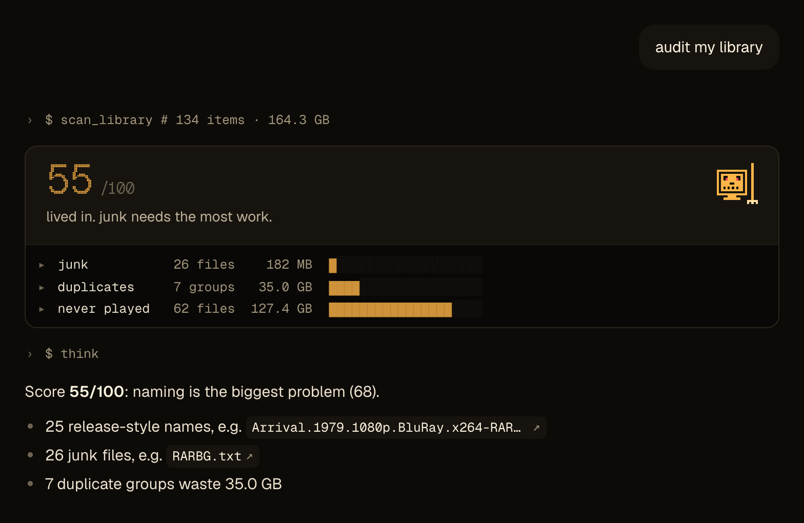
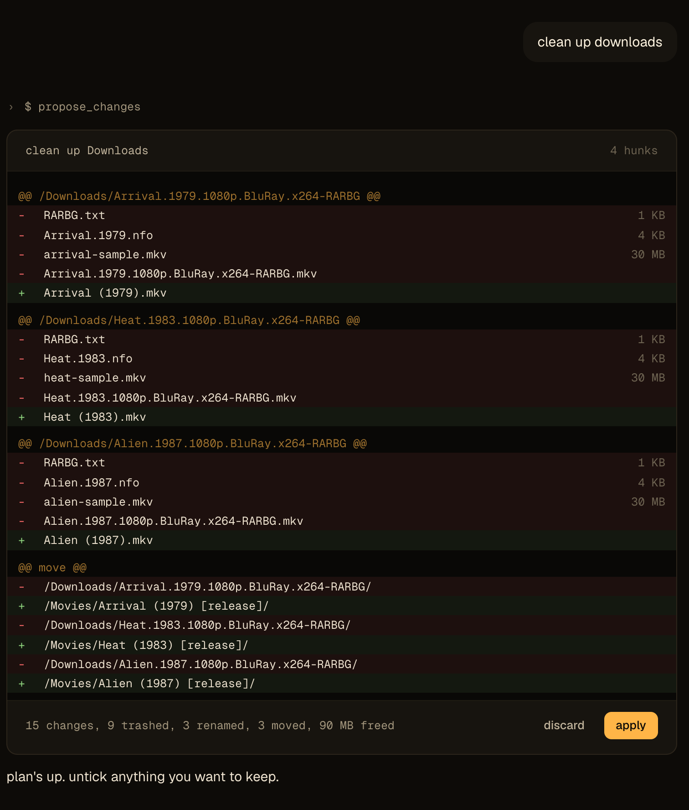

<p align="center">
  
</p>

<h1 align="center">puterminator</h1>

<p align="center">
  Chat with your put.io library and clean it up.
  <br />
  <a href="https://puterminator.com"><b>puterminator.com</b></a> · <a href="https://puterminator.com/privacy">privacy</a> · <a href="LICENSE">MIT</a>
</p>

<p align="center">
  
  
</p>

Sign in with put.io and ask in plain words. It's free: everyone gets 300 credits a month from a shared budget.

- Scores a folder for junk, duplicates, release-name clutter and wrapper folders.
- Finds files, plays videos in the browser and makes download links.
- Translates subtitles into another language.
- Shows every rename, move and trash as a plan. Nothing changes until you apply it, and undo reverses it.

Your messages, the file names they need and any subtitles you translate go to Anthropic's API. Trashed files go to your put.io trash. The [privacy page](https://puterminator.com/privacy) has the rest.

## Run it locally

Needs Node 24 and pnpm.

```sh
pnpm install
pnpm dev:fake
```

Opens <http://localhost:1337> with put.io and Anthropic faked. No keys needed.

For the real APIs, copy `.env.example` to `.env` and run `pnpm dev`. You need a put.io OAuth app whose callback is `<origin>/auth/callback`, and an Anthropic API key.

To deploy your own on Cloudflare Workers, set your domain in [`worker.ts`](src/server/worker.ts), attach it to the Worker in Cloudflare, and run `pnpm deploy`.

## Contributing

`pnpm verify` runs typecheck, lint, knip, tests and build. [AGENTS.md](AGENTS.md) maps the code, and [docs/architecture.md](docs/architecture.md) shows how it fits together.
