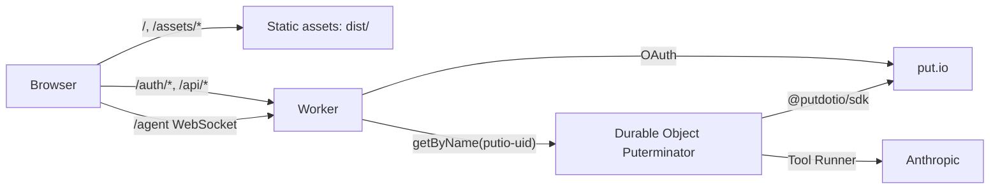

# puterminator

A conversational agent for your put.io library: it reads the tree, scores naming, structure, junk and duplicates, and answers questions. This version is read-only.

- One Cloudflare Worker plus one Durable Object per put.io user, declared and deployed with [Alchemy](https://alchemy.run) ([`alchemy.run.ts`](alchemy.run.ts)).
- Backend in [Effect](https://effect.website) 4; put.io through [`@putdotio/sdk`](https://github.com/putdotio/putio-sdk-typescript).
- The agent loop is the Anthropic TypeScript SDK Tool Runner on `claude-sonnet-5-5`, wrapped in Effect.
- UI in [Foldkit](https://foldkit.dev), styled after [`design/thread-reference.html`](design/thread-reference.html).

## Develop

```bash
pnpm install
cp .env.example .env   # fill in the values
pnpm dev               # vite build, then alchemy dev on http://localhost:1337
pnpm dev:client        # optional: Vite with HMR, proxying the Worker routes to :1337
```

Without put.io or Anthropic: `pnpm dev:fake`. It runs the same Worker and Durable Object under `alchemy dev` (stage `fake`, throwaway secrets), with both APIs served by [`dev-fake.ts`](src/server/testing/dev-fake.ts) on `:8788`.

- Sign-in runs the real OAuth routes against the fake. Prompts with "audit", "junk" or "folder" call tools; anything else streams a long reply to stop.
- `FAKE_UNCONFIGURED=1 pnpm dev:fake` shows the unconfigured state.
- `DEV_FAKE_UPSTREAM` routes put.io and Anthropic calls to the fake. Only a loopback `http` URL decodes, and a `prod` deploy with it set stops.

Register a put.io OAuth app at <https://app.put.io/oauth> with callback `<public URL>/auth/callback`.

## Check and deploy

```bash
pnpm typecheck && pnpm test && pnpm build
op run --env-file .env.op -- pnpm run plan     # build, alchemy plan --stage prod
op run --env-file .env.op -- pnpm run deploy   # typecheck, test, build, alchemy deploy --stage prod
```

`alchemy dev` does not typecheck; `pnpm typecheck` is the gate.

## Architecture

| Concern | Lives in |
| --- | --- |
| Infra: Worker, Durable Object, assets, domain, secrets | [`alchemy.run.ts`](alchemy.run.ts), props in [`src/server/worker.ts`](src/server/worker.ts) |
| Config read and validation (fail-closed) | [`src/server/config.ts`](src/server/config.ts) |
| HTTP routes, OAuth | [`src/server/routes.ts`](src/server/routes.ts), mounted by [`src/server/worker.ts`](src/server/worker.ts) |
| Session and OAuth state cookies | [`src/server/session.ts`](src/server/session.ts) |
| Durable Object `Puterminator` (sockets, storage binding) | [`src/server/agent.ts`](src/server/agent.ts) |
| Conversation, tools, credits | [`src/server/conversation.ts`](src/server/conversation.ts) |
| Tool Runner in Effect | [`src/server/runner.ts`](src/server/runner.ts) |
| v1 tables (state, token, usage, history, snapshot) | [`src/server/store.ts`](src/server/store.ts) |
| put.io reads, 429 policy | [`src/server/putio.ts`](src/server/putio.ts) |
| Scoring (pure) | [`src/server/audit.ts`](src/server/audit.ts) |
| Path rebuild from the flat file list (pure) | [`src/server/tree.ts`](src/server/tree.ts) |
| Wire contract (Effect Schema) | [`src/shared/contract.ts`](src/shared/contract.ts), [`src/shared/audit.ts`](src/shared/audit.ts) |
| Thread view model (`Item`, `Turn`, `toTurns`) | [`src/shared/thread.ts`](src/shared/thread.ts) |
| UI | [`src/client`](src/client) |

### Request flow



- Assets serve first, except `WORKER_ROUTES` in [`contract.ts`](src/shared/contract.ts), which the Worker handles. Unknown paths fall back to the SPA.
- `/auth/login` and `/auth/callback` run put.io OAuth. The callback stores the token in the user's Durable Object and sets an HMAC-signed session cookie.
- `/agent` checks the session and the Origin, then forwards the upgrade to the user's Durable Object. Browser and agent speak `ClientEvent` / `ServerEvent` as JSON frames. Both sides decode with Effect Schema; a frame that fails to decode is dropped.
- The Durable Object owns `AgentState` and sends it as a `state` frame on connect and on every change. The browser never writes state.
- The library scan reads every file in one flat listing (`/v2/files/list?parent_id=-1`, 2,000 per page) and rebuilds paths with `buildTree`. A per-folder walk hits put.io's per-window request limit.

### Tool Runner inside Effect

- A turn is a `Stream` of `partial`, `assistant` and `tool_results` events. `Stream.callback` runs `client.beta.messages.toolRunner(...)` inside `Effect.tryPromise`; its abort signal feeds the runner's `AbortController`, so interrupting the turn aborts the HTTP stream and running tools.
- Tools are `betaStandardSchemaTool` with `strict: true`. Input schemas are Effect Schemas with explicit JSON Schema: no `minimum`/`maximum` (use `Schema.Finite`, not `Schema.Int`), no optional keys, closed objects. Strict tool use on Sonnet 5.5 rejects the rest.
- Each tool runs its Effect with the turn's captured context, so a missing layer (put.io, storage) is a compile error.
- History stays append-only as Anthropic `BetaMessageParam` rows, so thinking signatures and the cached prefix stay valid.
- A `stop` frame interrupts the turn fiber. A turn that ends with an unanswered `tool_use` (stopped, or put.io rejected the token) gets an `is_error` tool result appended, so the next request stays valid. A put.io 401 also drops the stored token.
- put.io reads retry a 429 while `x-ratelimit-reset` is 10 s away or less, up to four times; a longer wait becomes a tool error with the retry time.

### Durable Object data

- The class and binding keep the v1 name `Puterminator`. Adoption matches the live namespace by that name and keeps its SQLite storage. Do not rename the class in the adopting deploy.
- v1 rows stay where the Agents SDK wrote them: `AgentState` JSON in `cf_agents_state` (row `cf_state_row_id`), plus the app tables `secrets`, `usage`, `messages` and `files`. The new Durable Object reads those tables; `AgentState` decodes unchanged.
- Instances are addressed by `getByName("putio-<user_id>")`, the same id v1's `getAgentByName` used.

### Secrets

- Every `Config` read in the Worker's construction phase becomes a secret binding on deploy. Values come from the deployer's environment, never from Cloudflare.
- Prod values live in 1Password item `uinaf/puterminator`; [`.env.op`](.env.op) maps them, and `op run` injects them without writing a file. A new `session-secret` signs every user out. `.env` stays local; `pnpm dev` reads it.
- An upload replaces the whole binding set. A live secret that is not read through `Config` is deleted.
- Required: `ANTHROPIC_API_KEY`, `PUTIO_CLIENT_ID`, `PUTIO_CLIENT_SECRET`, `SESSION_SECRET` (32+ characters). Optional: `MODEL`, `MONTHLY_TOKEN_CAP` (weighted tokens per month; one credit is 1,000).
- A missing required key fails the Worker's Init, so a deploy without it stops. A blank or short sign-in secret leaves the Worker up with `configured: false`; every route but `/api/me` then fails closed.
- The public URL is the Worker's URL output (the custom domain), not a variable.

### Deploy with Alchemy

- State is local (`.alchemy/`, gitignored). It holds secret values in plaintext. Lost state recovers: owned resources re-import on the next deploy.
- Stage `prod` deploys script `puterminator` on `puterminator.uinaf.dev` (zone `uinaf.dev`), with `workers.dev` off.
- The first `prod` deploy adopts the wrangler-deployed Worker. Only `prod` may adopt; other stages fail with `OwnedBySomeoneElse`.
- Adoption is one-way. Alchemy uploads Durable Objects through Cloudflare's declarative exports, so wrangler's `migrations` deploys stop working for this script.
- Auth: `CLOUDFLARE_ACCOUNT_ID` and `CLOUDFLARE_API_TOKEN` in the shell, from the `uinaf-cloudflare-workers-deploy` payload in `uinaf/vault` (`sops exec-env`). Alchemy reads them before the stack runs, so they never become Worker secrets.
- Token: Workers Scripts Write and Account Settings Read on the account, Workers Routes Write and Zone Read on `uinaf.dev`.

#### Adoption and rollback

- `alchemy plan` shows only a Worker `update`; Durable Object class changes are decided during the upload. The deploy log's `durable object reconciliation` line must show empty `deletedClasses` and `newSqliteClasses`.
- Rehearsed on 2026-10-29 with a throwaway v1 Worker: adoption kept the `Puterminator` namespace and its SQLite rows, v1 session cookies stayed valid, and live turns worked.
- `wrangler rollback` to a v1 version fails after adoption (`provisioned_class_missing_from_config`). Rollback is `pnpm run deploy` from an earlier commit of this stack.

- Pins: one `effect` for the whole graph via overrides in [`pnpm-workspace.yaml`](pnpm-workspace.yaml). Upgrade effect, foldkit, alchemy and `@putdotio/sdk` together.
