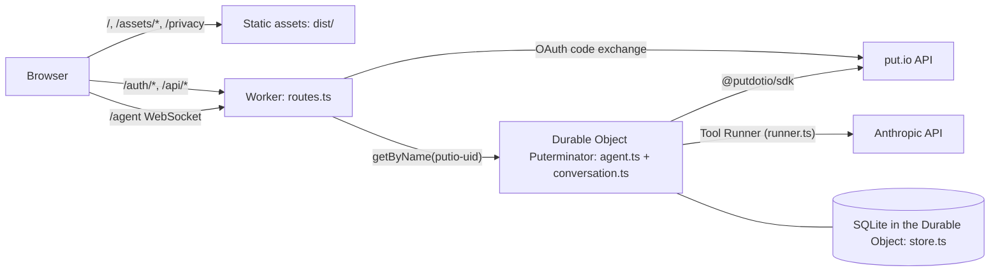
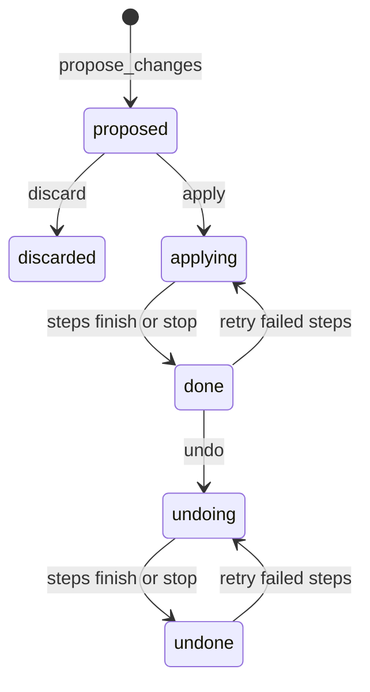
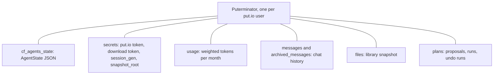

# Architecture

puterminator is a chat agent for one person's put.io library: a Cloudflare Worker routes each signed-in user to their own Durable Object, which runs the Claude tool loop against put.io and streams the conversation to the browser.

## Request flow



- Assets answer first. Only `WORKER_ROUTES` in [`contract.ts`](../src/shared/contract.ts) reach the Worker, and unknown paths fall back to the SPA.
- Every authenticated route checks the signed session cookie and its `session_gen` against the user's Durable Object, so sign-out ends every session at once.
- The browser and the Durable Object exchange `ClientEvent` and `ServerEvent` JSON frames ([`contract.ts`](../src/shared/contract.ts)). Both sides decode with Effect Schema and drop frames that fail.

## A turn

```mermaid
sequenceDiagram
  participant B as Browser
  participant D as Durable Object
  participant C as Anthropic
  participant P as put.io
  B->>D: send {text, folder}
  D->>D: append user message + <context>
  loop until end_turn, ask_user, or credits run out
    D->>C: messages (append-only history)
    C-->>D: streamed thinking, text, tool_use
    D-->>B: partial frames
    D->>P: tool reads (scan, download links)
    D->>D: tool results; snapshot reads from SQLite
    D-->>B: message frames, cards decode tool results
  end
  D-->>B: state {busy: false}
```

- History rows are Anthropic `BetaMessageParam`s, appended and never edited, so thinking signatures and the cached prompt prefix stay valid.
- Tools see only the snapshot of the folder last scanned. The snapshot records its root folder, and tools refuse to answer from a scan of another folder.

## Plans

The model can only propose. Every write to put.io starts from a browser frame.



- A run is one put.io write per change, in order, then a rescan. Writes are never retried automatically: a lost response could mean put.io already applied it, so the step is marked "may have happened" and undo reverses it too.
- Trash goes to put.io's trash. With trash off in the account, trash steps fail instead of deleting for good.

## Durable Object storage



- The class name, the `putio-<user_id>` instance names and the v1 tables carry users' data across deploys.
